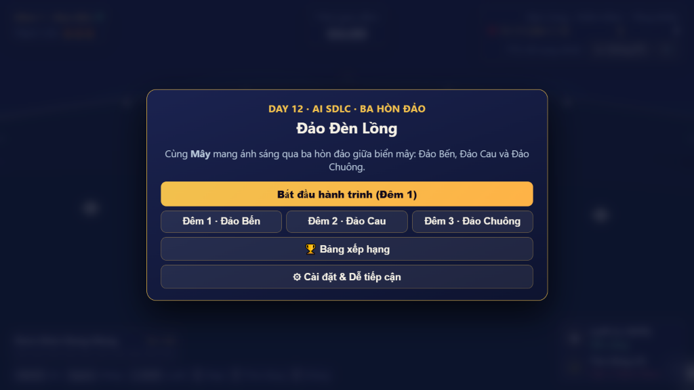
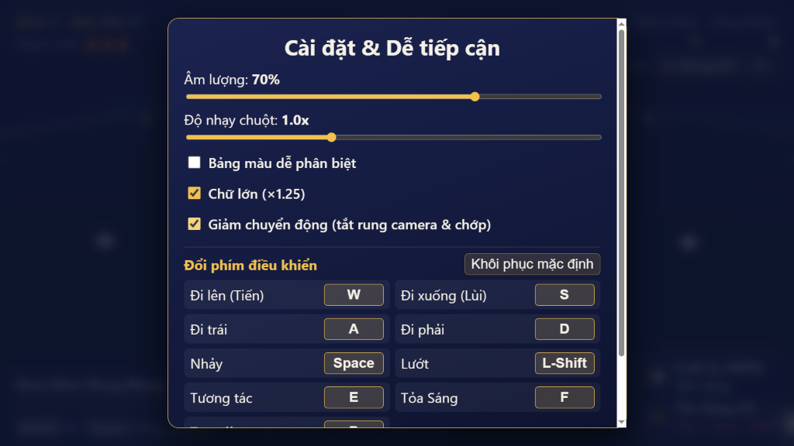
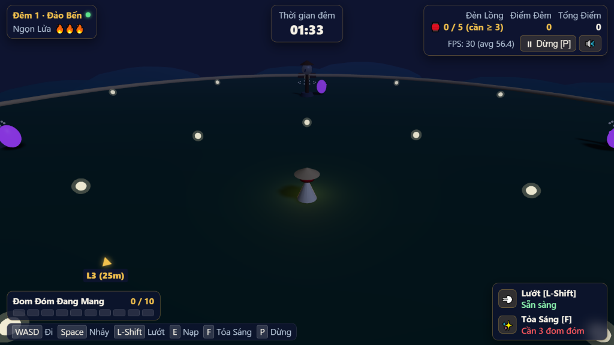

# Đảo Đèn Lồng — Bình minh (`v1.0.0` · Contract `v1.3`)

> **Bản phát hành `v1.0.0`:** [GitHub Release v1.0.0](https://github.com/hiepquangnguyen/K5-L3A-DAY12-NguyenQuangHiep-2A202603509-AI-SDLC-Dao-Den-Long/releases/tag/v1.0.0) (kèm gói cài nhanh `dao-den-long-v1.0.0-portable.zip`; tệp video demo `< 5 phút` `demo.mp4` sẽ được tải trực tiếp lên trang Release này).
> Tài liệu đề bài gốc: [docs/lab/LAB_README.md](docs/lab/LAB_README.md) · Quyết định kiến trúc: [ADR-001](docs/notes/ADR-001-lantern-fuel-and-dawn-win.md) · Tổng kết dự án: [Retrospective](docs/notes/retro.md) · Nhật ký thay đổi: [CHANGELOG.md](CHANGELOG.md).

**Đảo Đèn Lồng** là game hành động – sinh tồn 3D góc nhìn thứ ba viết bằng **Python 3 chuẩn (`stdlib`)** kết hợp **Three.js r170 (MIT)**. Người chơi hóa thân thành **Mây** vượt qua **3 Đêm** (**Đảo Bến**, **Đảo Cau**, **Đảo Chuông**): thu thập đom đóm, thắp sáng và châm dầu Đèn Lồng Lớn, xua đuổi **Bóng Mực** và **Gió Lạc** để giữ ánh sáng qua ngưỡng bình minh.

| Menu chính & Bảng xếp hạng (`1280×720`) | Cài đặt & Dễ tiếp cận | Đêm 1 · Đảo Bến (`18px`) |
|---|---|---|
|  |  |  |

---

## 1. Cài đặt & Chạy game (≤ 3 lệnh, 0 thư viện ngoài)

### Yêu cầu hệ thống
- **Python:** Python `3.10+` (đã kiểm chứng trên Python `3.13.11`), chỉ dùng thư viện chuẩn (`stdlib`), **không cần `pip` hay `npm`**.
- **Trình duyệt (chỉ cho 3D & `--bench`):** Chrome / Microsoft Edge / Chromium hỗ trợ WebGL2 (khuyên dùng độ phân giải `1280×720` trở lên). Chế độ mô phỏng headless, soak test và unit tests chạy hoàn toàn không cần màn hình/GPU.

### Chạy từ mã nguồn (`≤ 3` lệnh)
```bash
git clone https://github.com/hiepquangnguyen/K5-L3A-DAY12-NguyenQuangHiep-2A202603509-AI-SDLC-Dao-Den-Long.git
cd K5-L3A-DAY12-NguyenQuangHiep-2A202603509-AI-SDLC-Dao-Den-Long
python3 -m src.play
```
*(Trên Windows thay `python3` bằng `python`, hoặc nhấp đúp [`run.bat`](run.bat); trên macOS/Linux có thể chạy `./run.sh`.)*

### Chạy qua Docker (tùy chọn)
```bash
docker build -t dao-den-long:v1.0.0 .
docker run --rm -p 8765:8765 dao-den-long:v1.0.0
```
Sau đó mở `http://127.0.0.1:8765/` trên trình duyệt. Có thể truyền `--port 8080`, `--seed 42`, `--no-open`.

---

## 2. Điều khiển & Dễ tiếp cận (Accessibility)

Tất cả **9 phím điều khiển chính** đều đổi được trong **Cài đặt (`⚙ Cài đặt & Dễ tiếp cận`)**, có cảnh báo trùng phím ngay lập tức, nút **Khôi phục mặc định** và lưu vào `localStorage`:

| Hành động | Phím mặc định | Đổi được |
|---|---|---|
| Di chuyển (Lên / Xuống / Trái / Phải) | `W` `S` `A` `D` *(cũng hỗ trợ phím mũi tên)* | Có (4 nút) |
| Nhảy (`7.0 m/s`) | `Space` | Có |
| Lướt (`14.0 m/s`, `0.2s`, hồi `1.5s`) | `Left Shift` | Có |
| Nạp / Thắp / Châm dầu đèn (`≤ 2.0m`) | `E` | Có |
| Tỏa Sáng (tốn `3` đom đóm, `5.0m`, hồi `3.0s`) | `F` *(mặc định phụ: `J`)* | Có |
| Tạm dừng / Tiếp tục | `P` *(mặc định phụ: `Esc`)* | Có |
| Xoay camera 3D / Tắt-bật âm thanh | Kéo chuột hoặc `Q` / `C` · `M` | Phím cố định |

### Tính năng Tiếp cận (Phase 4)
1. **Chữ rõ ≥ 18px & Chữ lớn (`×1.25`):** Cỡ chữ gốc đặt ở `18px` tại `1280×720`; bật **"Chữ lớn (×1.25)"** phóng to toàn bộ HUD và bảng menu lên `22.5px`.
2. **Phụ đề trực quan & Mũi tên hướng Bóng Mực:** Hiển thị chú thích chữ trên `#hud-captions` kèm mũi tên viền màn hình khi **Bóng Mực vừa xuất hiện (`shade_spawned`)**, **gió mạnh sắp thổi**, **10 giây cuối**, hoặc **đèn sắp cạn dầu (`< 30`)**.
3. **Giảm chuyển động (`Reduced Motion`):** Tắt rung camera khi va chạm/hồi sinh, tắt chớp sáng màn hình và tắt hoạt ảnh/chuyển tiếp CSS.
4. **Bảng màu dễ phân biệt (`Colorblind Mode`):** Đổi viền/mắt Bóng Mực `#7A3CFF → #00B3FF` và cảnh báo `#FF5A5F → #FFFFFF` kèm biểu tượng `⚠`, kết hợp khác biệt hình học đèn tắt (`-20%` chiều cao + vệt rách giấy).

---

## 3. Bảng xếp hạng, Benchmark, Soak & Kiểm chứng (`Contract v1.3`)

- **Bảng xếp hạng Top 10:** Người chơi lưu tên (`3–12` ký tự `[A-Za-z0-9_]` hoặc chữ tiếng Việt có dấu, không khoảng trắng) sau khi thắng **Bình minh Đêm 3** hoặc khi **thua ở bất kỳ Đêm nào**. Dữ liệu lưu bền vững tại `data/leaderboard.json` (tùy biến qua `DDL_LEADERBOARD_PATH`), sắp xếp theo `(-score, earlier achieved_at)`, xem trong **🏆 Bảng xếp hạng** tại Menu chính hoặc xuất JSON:
  ```bash
  python3 -m src.play --export-leaderboard out.json
  ```
- **Benchmark đồ họa 3D (`1280×720`, 200 Shades + 100 Motes + L1–L3 sáng, 3s warm-up + 30s đo):**
  ```bash
  python3 -m src.bench --seed 42 --duration 30 --out bench.json
  ```
  *Ghi chú vsync:* Trên Windows (`Microsoft Edge`) / Chromium, `src.bench` truyền `--disable-frame-rate-limit --disable-gpu-vsync --disable-features=CalculateNativeWinOcclusion` nên tắt vsync thành công (`"vsync_off": true`). Kết quả chuẩn trên Intel HD Graphics 630 iGPU ([bench.json](bench.json)): **`avg_fps = 142.6`**, **`p1_low_fps = 36.1`**, **`frame_ms_p95 = 12.6 ms`**, **`load_ms = 1862 ms`**.
- **Soak test ổn định (`10` Đêm `1→2→3` liên tục):**
  ```bash
  python3 -m src.soak --seed 7 --nights 10 --out soak.json
  ```
  Kết quả chuẩn ([soak.json](soak.json)): **`crashes = 0`**, bộ nhớ **`17.4 → 17.5 MiB`** (`5.41s`).
- **Kiểm thử tự động, Gate & Headless (`41` unit/contract tests):**
  ```bash
  python3 .agents/hooks/verify_gate.py
  python3 -m src.headless --seed 1 --night 3 --ticks 18000 --out out.jsonl
  ```

---

## 4. Cấu trúc dự án

- `src/sim/` — Lõi mô phỏng 60Hz (`engine.py`, `maps.py`, `config.py`, `prng.py`, `validation.py`, `leaderboard.py`, `sysmem.py`)
- `src/play.py`, `src/headless.py`, `src/bench.py`, `src/soak.py` — Máy chủ 3D + API `/api/leaderboard`, CLI headless `v1.3`, benchmark 3D, soak test
- `web/` — Giao diện 3D Three.js r170, cảnh benchmark (`bench.html` / `bench.js`), Bảng xếp hạng, Đổi phím, Tiếp cận
- `tests/` — `41` kiểm thử đơn vị & Test Contract `v1.0–v1.3`
- `scripts/` — `run_phase3_verification.py`, `run_phase4_verification.py`, `build_release.py` (đóng gói `dist/dao-den-long-v1.0.0-portable.zip`)
- `docs/notes/` — `retro.md`, `ADR-001-lantern-fuel-and-dawn-win.md`, `phase-1..4-evaluation.md`, `ai-log.md`
- `docs/proof/` — Bằng chứng thực tế và ảnh chụp `1280×720` qua `phase-1/` → `phase-4/`
- `Dockerfile`, `run.sh`, `run.bat`, `CHANGELOG.md`, `CREDITS.md`, `LICENSE`
